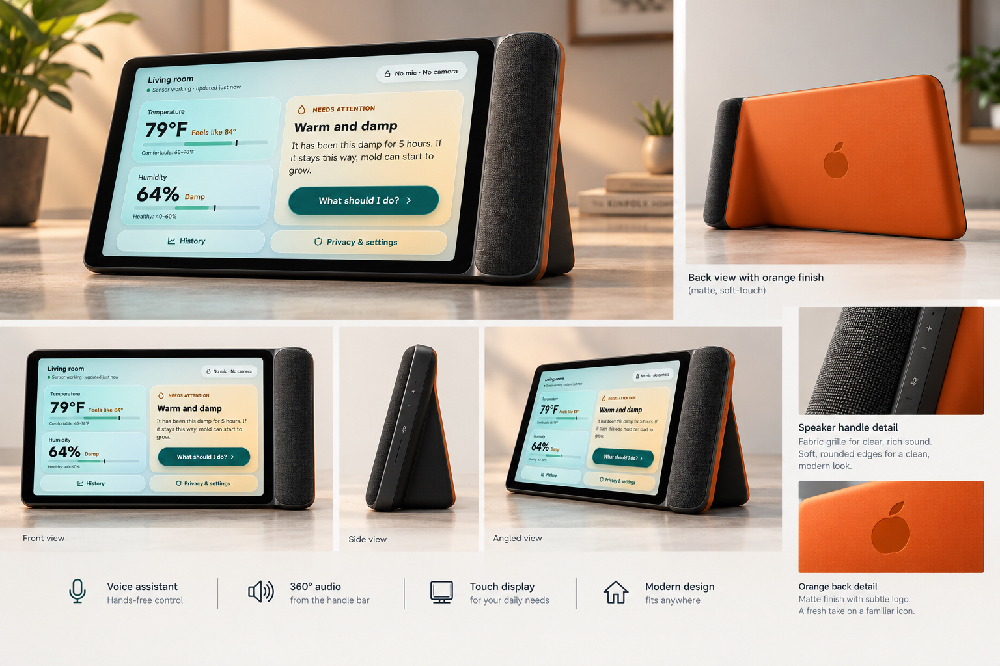

## Product Concept Brief: 

Our product is named "Orange", which targets families with busy schedules, older adults, and teens. Our value proposition is $350, 
with our competitive position being a one-time fee rather than a subscription. In order to compete with brand names like
Apple's Home, we offer a cheaper, more affordable solution.

## Competitive Analysis: 

Our selected reference products were Apple's Home and Amazon's Alexa. While those options could potentially be cheaper at first,
many of the features in those products are locked behind a subscription like Amazon Prime. We understand that because we are
a cheaper, lesser known brand, we are limited in appeal and plan to use our one-time price in marketing.

## Design evolution portfolio: 

Below are our initial concepts for the Orange, with the AI assisted mockups. We wanted to have a familiar screen design, but with an added
physical feature that lets users move around their Orange. Users can utilize this movement to change the position of the Orange around their living space,
allowing for users to change light colors and measure temperature and humidity around the house.

%402x.jpeg)

## HCI rationale: 
We wanted to prioritize the original feel of smart home devices, which meant keeping the tablet-centered design. However, we also wanted to innovate on 
the inconvenience given by existing devices, as you cannot move them around the house, so we implemented a side bar speaker combination that allows for users to 
move the Orange about their house. The trade-offs for this design are the battery needed to power the device, as its no longer just being plugged into the wall, as well as
concerns that come from having speakers being touched constantly if the device is moved a lot.

## Working prototype:

The code in this repository gives everything needed for the Orange to work on a Raspberry PI.

## Usability evaluation:

We found the touchscreen to sometimes be clunky to use, in particular with our UI/UX. We also found the humidity/temperature sensor taking longer
times to read, as well as no feedback on when the given human temperature is the same as the room temperature. We improved on this by refining the UI/UX very slightly so that 
the most important readings are larger than other information. 

## Commercialization proposal:

We wanted to target families that are considering a smart home device, such as Alexas or Homes, but wish to go with a non-subscription device. 
Additionally, we also wanted to target older adults for the temperature taking features, and younger adults that wish to control the light colors in their houses.
At $350, we placed the price on the more luxurious end of a smart home device, which would put the Orange against a very capable Alexa. 
We believe that a one time fee is better than a subscription model, and we knew the risk involved in hoping that users would choose the one time option,
seeing as the Orange is not a product that would be as widely known in store shelves. 

# AI reflection: 

AI helped us form our mock ups and image examples when we lacked the artistic capabilities to sketch final designs. It was unhelpful when wanting to change
smaller aspects of the design and our team consistently changed decisions that violated HCI principles, such as a cluttered home screen. Our team voted together
on which features should be kept from the AI suggestions and which should be removed.
